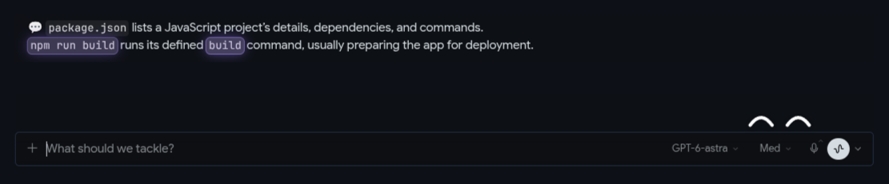
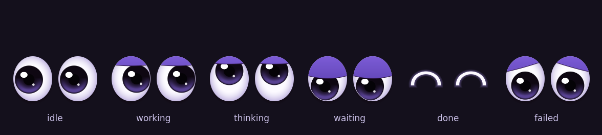

# Hermes Eyes 👀

A pet for [Hermes Agent](https://github.com/NousResearch/hermes-agent) that
works for you: a pair of googly eyes that watch your agents so you don't have
to keep checking every chat.



Two parts, install either or both:

- **Desktop plugin**: the eyes live on the Hermes Desktop message box.
- **Terminal pet**: an "eyes" pet for the Hermes CLI and TUI (and Desktop's
  own pet slot) that acts out what the agent is doing.

## In Hermes Desktop

**They read along**
- They follow your mouse and blink. While the agent thinks they look up,
  they glance at each tool it runs, and smile when it's done.
- As a reply streams in, its letters fly out of the eyes and land on the
  newest word.
- File names, commands, links and numbers fly out whole, as a little tag, and
  make that word glow in the reply.

**They point at what needs you**
- An approval or a question in the chat in front of you: the eyes shoot a "!"
  at the Approve button and a ring pulses around it until you answer.
- A chat in another tab finishes, needs approval or asks a question: the
  status-bar chip says **"1 waiting"**. One click takes you there; with several,
  a list shows who is waiting, why, and what they last said.
- An agent working but silent for 3 minutes: the eyes squint and say
  **"might be stuck"**.
- Something fails: worried eyes, and a red **"1 problem"** chip for other tabs.
- Step away and they doze off. Come back and **"While you were away"** lists
  everything that finished.

**And they're a pet**
- Hover them: "Ada · running terminal · 20s".
- Each agent gets its own eye colour (the one Hermes shows in the sidebar).
- Press and hold to pet them: happy eyes and little hearts.
- A task that ran over a minute finishes: a burst of sparks.
- Drag them anywhere; the list can put them back, or hide them.

While the eyes show, Hermes's own floating pet is hidden in that window.

## In the terminal



The "eyes" pet is a [petdex](https://github.com/crafter-station/petdex) sprite
atlas. Hermes picks the row from what the agent is doing and draws it in the
classic CLI, the TUI and Desktop.

## Install

**Ask your Hermes agent**:

```sh
hermes skills install https://raw.githubusercontent.com/BkashJEE/hermes-eyes/main/skills/install-hermes-eyes/SKILL.md
```

then say *"install Hermes Eyes"*. The skill asks which parts and which
profiles you want, shows a dry run, and installs.

**Or run the installer** (Python 3, standard library only; Linux, macOS,
Windows):

```sh
git clone https://github.com/BkashJEE/hermes-eyes
cd hermes-eyes
python3 install.py --dry-run     # see the plan
python3 install.py               # Desktop plugin + pet for the default profile
hermes pets select eyes          # make it the active pet
```

Options: `--profile NAME` (repeatable), `--all-profiles`, `--select`,
`--no-pet`, `--no-desktop`, `--uninstall`, `--hermes-home PATH`.

**Desktop plugin only, from inside Hermes Desktop**: Capabilities → Plugins →
Install from Git → `BkashJEE/hermes-eyes`, or open this link:

```
hermes://plugin/install?repo=BkashJEE/hermes-eyes
```

Enable it in Capabilities → Plugins if it isn't already.

**By hand**: copy `desktop/plugin.js` to
`~/.hermes/desktop-plugins/hermes-eyes/plugin.js`, and `pet/eyes/` to
`~/.hermes/pets/eyes/` (or `~/.hermes/profiles/NAME/pets/eyes/`). Desktop picks
the plugin up within a few seconds.

## Remove

```sh
python3 install.py --uninstall --all-profiles
```

## What it touches

The plugin reads Hermes Desktop's own state and events (which chats are busy,
the reply as it streams, approvals, tool steps) and the page itself. It makes
no network requests, sends nothing anywhere, and stores only its own settings
(where you put the eyes, whether they're hidden) in the plugin storage Hermes
gives it. The installer only copies files into your Hermes home and, with
`--select`, runs `hermes pets select eyes`.

## Development

```sh
node --test tests/plugin.test.mjs   # import contract + word detection
python3 tools/make-pet.py       # rebuild pet/eyes (needs ImageMagick)
```

Edit `desktop/plugin.js` in place under `~/.hermes/desktop-plugins/hermes-eyes/`
and Desktop hot-reloads it. The plugin follows the
[Desktop plugin SDK](https://hermes-agent.nousresearch.com/docs/developer-guide/desktop-plugin-sdk):
one uncompiled ES module that imports only `@hermes/plugin-sdk`, `react` and
`react/jsx-runtime`.

## License

[Apache-2.0](LICENSE)
